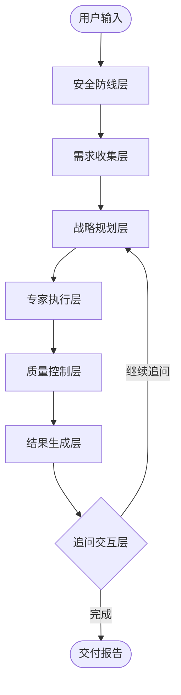

# 🎨 Intelligent Project Analyzer

> 基于 LangGraph 的多智能体设计项目分析系统  
> 智能化设计项目需求分析 | 多专家协作 | 全流程质量保障

[](CHANGELOG.md)
[](https://www.python.org/)
[](LICENSE)
[](https://github.com/dafei0755/ai/actions/workflows/ci.yml)
[](https://codecov.io/gh/dafei0755/ai)
[](https://github.com/langchain-ai/langgraph)
[](https://fastapi.tiangolo.com/)
[](https://nextjs.org/)

---

## ⚠️ 开发者必读

**修改代码前必须阅读**：
- 🔥 **[核心开发规范](.github/DEVELOPMENT_RULES_CORE.md)** - 200行精简版，AI工具优先加载
- 📚 [完整开发规范](.github/DEVELOPMENT_RULES.md) - 深度查阅特定章节
- ✅ [变更检查清单](.github/PRE_CHANGE_CHECKLIST.md) - 修改前强制流程
- 📖 [历史修复记录](.github/historical_fixes/) - 5+ 精选bug修复案例

**强制流程**：诊断问题 → 查阅历史 → 报告方案 → 获得批准 → 执行修改 → 更新文档

---

## 📋 项目简介

**Intelligent Project Analyzer** 是一个专为设计项目打造的智能分析系统。系统采用 **LangGraph 多智能体协作**架构，结合大语言模型（LLM）的推理能力，实现从需求分析到专家协作、质量审核的全流程自动化。

## 🧩 Skills 文档

- [Skills 使用与维护手册](docs/features/skills/SKILLS.md)

### ✨ 核心特性

- **🤖 动态多智能体协作** - 6大核心智能体层级（需求分析、可行性评估、项目规划、专家执行、质量控制、报告生成）
- **💬 智能人机交互** - 三步递进式问卷系统（核心任务拆解 → 雷达图维度 → 差距填补）+ 需求洞察节点  
- **🔍 外部搜索工具集成** - 4种搜索工具（Tavily网络搜索、Bocha中文AI、ArXiv学术论文、Milvus知识库）v7.122 数据流优化  
- **🛡️ 多层质量保障** - 前置质量预检 + 挑战检测 + 人工审核 + 报告安全审核  
- **⚡ 性能优化** - v7.502真并行执行（批次执行67%加速）+ 智能上下文压缩（节省15-50% Token）+ WebSocket实时推送  
- **🎨 动态批次调度** - 依赖感知的智能批次执行（V3-V4-V5 → V2-V6）支持1-N批次灵活扩展  
- **🔌 扩展能力** - 多模态输入（文本/PDF/图片OCR）+ WordPress SSO + 动态本体论注入

### 🎯 适用场景

室内设计 | 产品设计 | 品牌设计 | 咨询服务 | 战略规划

### 🏆 项目优势

- ✅ **降低沟通成本** - 智能问卷系统精准捕获需求
- ✅ **提升专业度** - 任务导向专家 + 分层本体论知识注入
- ✅ **保障质量** - 三层质量防护网（预检 → 执行监控 → 事后审核）
- ✅ **提高效率** - 真并行执行 + 上下文压缩（2-3天缩短至30分钟）
- ✅ **可追溯性** - 完整过程记录 + WebSocket实时推送

---

## � 完整工作流程架构

系统采用**六阶段流水线架构**，25+流程节点协同工作，实现从需求输入到报告交付的全流程自动化。

### 📊 流程总览图



### 🛡️ 阶段一：安全防线层（4个节点）

**职责**：多层次内容安全检测与领域适配性验证

| 节点ID | 节点名称 | 核心功能 | 输出 |
|--------|---------|---------|------|
| N01 | `unified_input_validator_initial` | **初始验证**：内容安全检测、领域分类、任务复杂度评估 | `domain_type`, `task_complexity`, `rejection_reason` |
| N02 | `unified_input_validator_secondary` | **二次验证**：需求分析后的领域一致性检查、领域漂移检测 | `domain_drift_detected`, `secondary_validation_result` |
| N03 | `input_rejected` | **拒绝终止**：不符合要求的输入直接终止流程 | `rejection_reason`, `rejection_message` |
| N04 | `report_guard` | **报告审核**：生成报告前的内容安全与领域过滤 | `report_safety_status`, `filtered_content` |

**关键特性**：
- ✅ 双重验证机制（初始 + 二次）防止领域漂移
- ✅ 智能任务复杂度评估（simple/medium/complex）
- ✅ 报告级内容安全防护（敏感信息过滤）

---

### 📝 阶段二：需求收集层（7个节点）

**职责**：深度挖掘用户需求，生成结构化需求文档

| 节点ID | 节点名称 | 核心功能 | 输出 |
|--------|---------|---------|------|
| N05 | `requirements_analyst` | **需求分析师（V1）**：解析用户输入，提取核心需求、约束条件、交付物预测 | `structured_requirements`, `project_type`, `deliverable_owner_map` |
| N06 | `feasibility_analyst` | **可行性分析师（V1.5）**：后台决策支持，预算/时间/空间冲突检测、需求优先级计算 | `feasibility_assessment`, `conflict_detection`, `priority_matrix` |
| N07 | `progressive_step1_core_task` | **Step 1：核心任务拆解**：将项目拆解为可执行的核心任务，用户确认任务合理性 | `core_tasks_decomposition`, `confirmed_core_tasks` |
| N08 | `progressive_step2_radar` | **Step 2：雷达图维度选择**：混合策略（70%固定+30%LLM动态）生成维度，用户选择关注点 | `selected_dimensions`, `radar_chart_config` |
| N09 | `progressive_step3_gap_filling` | **Step 3：差距填补追问**：针对性追问关键信息缺口（预算、时间、偏好等） | `gap_filling_answers`, `supplementary_info` |
| N10 | `questionnaire_summary` | **需求洞察节点（v7.135）**：智能重构问卷答案，生成结构化需求文档，支持用户微调确认 | `questionnaire_summary`, `structured_requirements_v2` |

**关键特性**：
- ✅ 三步递进式问卷（逐步深化，避免信息过载）
- ✅ 可行性分析后台运行（不干扰用户交互体验）
- ✅ 需求洞察（合并了原需求确认功能，v7.151）

---

### 🎯 阶段三：战略规划层（6个节点）

**职责**：专家团队组建、任务分派、质量预检

| 节点ID | 节点名称 | 核心功能 | 输出 |
|--------|---------|---------|------|
| N11 | `project_director` | **项目总监**：基于需求选择专家角色（6层级22+专家）、制定执行批次策略 | `active_agents`, `execution_batches`, `strategic_analysis` |
| N12 | `deliverable_id_generator` | **交付物ID生成器（v7.108）**：为每个专家预生成交付物ID，支持概念图精准关联 | `deliverable_metadata`, `deliverable_id_map` |
| N13 | `search_query_generator` | **搜索查询生成器（v7.109）**：为交付物生成搜索查询、概念图配置（prompt/aspect_ratio） | `search_queries`, `concept_image_configs` |
| N14 | `role_task_unified_review` | **统一审核节点**：合并角色选择审核和任务分派审核，支持用户修改专家团队和任务分配 | `unified_review_result`, `skip_unified_review` |
| N15 | `quality_preflight` | **质量预检（静默模式）**：前置预防第1层，风险预判、质量检查清单生成、能力匹配度验证 | `quality_checklists`, `risk_assessment`, `preflight_warnings` |

**关键特性**：
- ✅ 动态专家选择（基于项目类型+需求复杂度）
- ✅ 交付物责任者映射自动校正（预测 → 实际）
- ✅ 统一审核（减少50%人机交互次数）

---

### 🚀 阶段四：专家执行层（5个节点）

**职责**：动态批次调度，真并行专家分析

| 节点ID | 节点名称 | 核心功能 | 输出 |
|--------|---------|---------|------|
| N16 | `batch_executor` | **批次执行器（v7.502真并行）**：使用asyncio.gather实现真正并行执行，批次内所有专家同时运行 | `agent_results` (批量更新) |
| N17 | `agent_executor` | **单个专家执行器**：任务导向专家工厂，支持工具调用（Tavily+Bocha+Arxiv+Milvus）、概念图生成 | `agent_results[role_id]`, `concept_images` |
| N18 | `batch_aggregator` | **批次聚合器**：收集批次内所有专家输出，合并agent_results，触发WebSocket渐进式推送 | `agent_results` (合并), `batch_completed` |
| N19 | `batch_router` | **批次路由器**：检查当前批次进度，决定进入下一批次 or 进入质量控制 | `current_batch`, `all_batches_completed` |
| N20 | `batch_strategy_review` | **批次策略审核（v3.6）**：支持三种模式（manual/automatic/preview），用户确认批次执行计划 | `batch_strategy_approved`, `batch_skipped` |

**关键特性**：
- ✅ **真并行执行**（v7.502）：Batch1 10s→3.3s（67%加速），Batch2 6s→2s（67%加速）
- ✅ **依赖感知调度**：V3/V4/V5（独立专家）→ V2/V6（依赖前序输出）
- ✅ **智能上下文压缩**（v7.502 P1）：节省15-50% Token，同时保持上下文完整性
- ✅ **渐进式结果推送**：单个专家完成即推送，前端实时展示

**批次执行示例**：
```
Batch 1 (并行): V3_空间叙事专家 + V4_设计研究员 + V5_场景体验专家
              ↓ (依赖关系)
Batch 2 (并行): V2_设计总监 + V6_总工程师
```

---

### 🛡️ 阶段五：质量控制层（2个节点）

**职责**：挑战检测、人工审核兜底

| 节点ID | 节点名称 | 核心功能 | 输出 |
|--------|---------|---------|------|
| N21 | `detect_challenges` | **挑战检测（v3.5）**：分析专家输出中的challenge_flags，统计must_fix/should_fix/nice_to_have问题 | `challenge_summary`, `total_critical_issues` |
| N22 | `manual_review` | **人工审核节点**：当critical_issues>3时触发，暂停流程等待用户裁决（继续/终止/选择性整改） | `manual_review_result`, `selected_fixes` |

**关键特性**：
- ✅ 自动问题等级划分（must_fix / should_fix / nice_to_have）
- ✅ 人工审核阈值可配置（默认>3个must_fix触发）
- ✅ 支持选择性整改（用户选择关键问题重跑专家）

---

### 📊 阶段六：结果生成层（3个节点）

**职责**：结果聚合、报告生成、追问交互

| 节点ID | 节点名称 | 核心功能 | 输出 |
|--------|---------|---------|------|
| N23 | `result_aggregator` | **结果聚合器**：整合所有专家输出，生成统一的最终报告草稿（JSON格式） | `final_report`, `aggregated_insights` |
| N24 | `pdf_generator` | **PDF报告生成器**：基于HTML模板生成可视化PDF报告，包含雷达图、概念图、专家分析 | `pdf_path`, `report_metadata` |
| N25 | `user_question` | **用户追问节点（可选）**：支持报告生成后的追问交互，重新调用project_director分析 | `additional_questions`, `followup_results` |

**关键特性**：
- ✅ 报告模板化（支持HTML模板自定义）
- ✅ 自动图表生成（雷达图、概念图）
- ✅ 追问循环（用户可反复追问直到满意）

---

### 🔗 流程控制与路由逻辑

#### 1. **Command 动态路由**（无需静态边）
```python
# 示例：三步问卷的动态路由
progressive_step1_core_task → Command(goto="progressive_step2_radar" | "requirements_analyst")
progressive_step2_radar → Command(goto="progressive_step3_gap_filling" | "progressive_step1_core_task")
progressive_step3_gap_filling → Command(goto="questionnaire_summary")
```

#### 2. **条件边路由**（基于状态判断）
```python
batch_router → {
    "batch_strategy_review" if current_batch < total_batches else "detect_challenges"
}
detect_challenges → {
    "revisit_requirements" if drift_detected,
    "manual_review" if critical_issues > 3,
    "result_aggregator" if all_passed
}
```

#### 3. **批次循环路由**（支持1-N批次）
```
batch_executor → batch_aggregator → batch_router
                                    ↓ (check)
                            batch_strategy_review → batch_executor (循环)
                                    ↓ (completed)
                              detect_challenges → ...
```

---

## �🚀 快速启动

📖 **详细安装指南**: [QUICKSTART.md](QUICKSTART.md)

### 一键启动（Windows）

```cmd
# 1. 配置环境变量
copy .env.example .env
# 编辑 .env 填写 OPENAI_API_KEY

# 2. 安装依赖
pip install -r requirements.txt
cd frontend-nextjs && npm install && cd ..

# 3. 启动服务
start_services.bat
```

### 分步启动

```bash
# 1. 后端服务（Python 3.13 Windows 推荐）
python -B scripts\run_server_production.py

# 2. 前端服务（新终端）
cd frontend-nextjs && npm run dev

# 访问
# 前端: http://localhost:3001
# API: http://localhost:8000/docs
```

### Docker 部署

```bash
docker-compose up -d
```

---

## 📚 完整文档

| 类别 | 文档 | 说明 |
|------|------|------|
| **入门** | [QUICKSTART.md](QUICKSTART.md) | 5分钟快速启动 |
| **流程架构** | [README.md - 完整工作流程](#完整工作流程架构) | 25+流程节点详解（本文档第3章） |
| **贡献** | [CONTRIBUTING.md](CONTRIBUTING.md) | 贡献指南和开发规范 |
| **架构** | [docs/README.md](docs/README.md) | 完整文档导航 |
| **更新** | [CHANGELOG.md](CHANGELOG.md) | 版本历史 |
| **紧急** | [EMERGENCY_RECOVERY.md](EMERGENCY_RECOVERY.md) | 快速恢复到历史版本 |
| **备份** | [BACKUP_GUIDE.md](BACKUP_GUIDE.md) | 多版本备份系统 |
| **测试** | [README_TESTING.md](README_TESTING.md) | 测试指南 |
| **静态测试操作** | [docs/testing/STATIC_TESTING_OPERATIONS_GUIDE.md](docs/testing/STATIC_TESTING_OPERATIONS_GUIDE.md) | 自动/手动执行、节奏、边界与收益 |
| **腾讯云上线测试清单** | [docs/deployment/TENCENT_CLOUD_TESTING_CHECKLIST.md](docs/deployment/TENCENT_CLOUD_TESTING_CHECKLIST.md) | 开发/稳定/上线/运行全阶段可勾选清单 |
| **分支保护配置清单** | [docs/deployment/BRANCH_PROTECTION_SETUP_CHECKLIST.md](docs/deployment/BRANCH_PROTECTION_SETUP_CHECKLIST.md) | GitHub 分支保护一次性配置与验证步骤 |
| **人工治理操作手册** | [docs/deployment/MANUAL_GOVERNANCE_OPERATIONS.md](docs/deployment/MANUAL_GOVERNANCE_OPERATIONS.md) | 分支保护/白名单审批/发布签字的执行SOP |
| **自动治理工作流** | [.github/workflows/ops-auto-incident.yml](.github/workflows/ops-auto-incident.yml) | 失败自动建单 + 可选告警推送 |
| **分支保护周审计** | [.github/workflows/branch-protection-audit.yml](.github/workflows/branch-protection-audit.yml) | 自动检查 main 保护规则漂移并建单 |
| **白名单月复核提醒** | [.github/workflows/security-allowlist-review.yml](.github/workflows/security-allowlist-review.yml) | 每月自动创建安全白名单复核任务 |
| **机制复盘** | [docs/mechanism-reviews/](docs/mechanism-reviews/INDEX.md) | 核心机制深度解析 |

### 核心开发文档

- 🔥 [核心开发规范](.github/DEVELOPMENT_RULES_CORE.md) - AI工具优先加载
- 📚 [完整开发规范](.github/DEVELOPMENT_RULES.md) - 详细指南
- ✅ [变更检查清单](.github/PRE_CHANGE_CHECKLIST.md) - 修改前强制流程
- 📖 [历史修复案例](.github/historical_fixes/) - 5+ 精选修复记录

### 机制复盘文档

- [📖 机制复盘索引](docs/mechanism-reviews/INDEX.md) - 核心机制系统性解析
- [🗜️ 智能上下文压缩策略](docs/mechanism-reviews/CONTEXT_COMPRESSION_GUIDE.md) - v7.502 动态压缩机制，节省15-50% Token
- [⭐ 专家输出质量优化方案](docs/mechanism-reviews/EXPERT_OUTPUT_QUALITY_OPTIMIZATION.md) - v1.0 **新增** 14个优化方向，质量提升50%，包含P0快速见效方案
  - [✅ P0优化1主报告](docs/implementation/P0_OPTIMIZATION_1_FEW_SHOT_IMPLEMENTATION.md) - Few-Shot示例库 (V2_0+V4_1完成，66.7%进度)
    - [✅ V4_1扩展报告](docs/implementation/P0_OPTIMIZATION_1_V4_1_EXTENSION.md) - 设计研究者示例库 (3个示例，14657字符) ⭐新增
- [🎭 专家角色定义系统](docs/mechanism-reviews/EXPERT_ROLE_DEFINITION_SYSTEM.md) - v2.8 配置驱动架构，22+专家角色，6000+行配置
- [🤖 动态专家机制](docs/mechanism-reviews/DYNAMIC_EXPERT_MECHANISM_REVIEW.md) - v7.17 角色选择、批次调度与性能瓶颈分析

### 功能文档

- [WordPress SSO集成](docs/features/wordpress-sso/) - 单点登录完整指南
- [搜索引用功能](docs/V7.120_SEARCH_REFERENCES_RELEASE.md) - v7.120 外部搜索工具集成
- [搜索查询数据利用优化](docs/V7.121_SEARCH_QUERY_DATA_UTILIZATION.md) - v7.121 充分利用用户输入和问卷数据
- [v7.502 性能突破](P0_OPTIMIZATION_IMPLEMENTATION_v7.502.md) - 真并行执行 + 智能提升

---

## 🧪 测试

```bash
pytest                      # 运行所有测试
pytest --cov=intelligent_project_analyzer --cov-report=html  # 覆盖率报告
pytest -m "not llm"         # 跳过LLM调用测试
```

CI 配置体检（建议提交前执行）：

```bash
python scripts/ci/ci_doctor.py        # 跨平台
scripts\ci\ci_doctor.bat              # Windows 一键入口
```

测试覆盖率: 80%+

---

## ❓ 常见问题

### Q: Python 3.13 Windows 用户启动失败？
A: 必须使用 `python -B scripts\run_server_production.py` 启动，详见 [Playwright修复文档](.github/historical_fixes/playwright_python313_windows_fix.md)

### Q: 端口被占用？
```bash
# Windows
taskkill /F /IM python.exe
Get-Process node | Stop-Process -Force
```

### Q: 如何切换LLM服务商？
编辑 `.env` 文件配置 `OPENAI_API_KEY` / `ANTHROPIC_API_KEY` / `GOOGLE_API_KEY`

更多问题参见 [QUICKSTART.md](QUICKSTART.md#常见问题)

---

## 🤝 贡献

我们欢迎所有贡献！请先阅读 [贡献指南](CONTRIBUTING.md)。

**贡献流程**: Fork → 创建分支 → 遵循规范 → 添加测试 → 更新文档 → 提交PR

---

## 🗺️ 路线图

**近期（2025 Q1）**: CI/CD完善 | 更多LLM支持 | 前端优化 | 多语言支持
**中期（2025 Q2-Q3）**: 移动端 | 团队协作 | 版本对比 | 导出PPT/Word
**长期愿景**: SaaS化 | AI训练优化 | 行业定制 | 开放API生态

---

## 📄 许可证

MIT License - 详见 [LICENSE](LICENSE)

---

## 🔗 相关链接

- 📺 [在线演示](https://ai.ucppt.com)（需 WordPress 登录）
- 🐛 [问题反馈](https://github.com/dafei0755/ai/issues)
- 💬 [讨论区](https://github.com/dafei0755/ai/discussions)
- 📖 [完整文档](docs/README.md)

---

<div align="center">

**当前版本**: v7.502 | **最后更新**: 2026-02-13

⭐ 如果这个项目对你有帮助，请给我们一个 Star！

Made with ❤️ by AI Assistant & Contributors

</div>

---

## 📌 版本亮点（v7.502）

### 🚀 P0性能突破
- **真并行批次执行**：使用asyncio.gather替代Send API串行，批次执行加速67%
- **智能上下文压缩**：动态压缩策略节省15-50% Token，保持上下文完整性

### 🧠 P1核心优化
- **分层本体论注入**：三层架构（meta_framework + 项目类型 + 专家强化）
- **渐进式结果推送**：单个专家完成即WebSocket推送，前端实时展示

### 🎯 流程改进
- **需求洞察节点**（v7.135）：智能重构问卷答案，合并原需求确认功能
- **统一审核节点**（v7.280）：合并角色+任务审核，减少50%交互次数
- **批次策略审核**（v3.6）：支持manual/automatic/preview三种执行模式

---

## 🔧 技术架构详解

### 后端c
- **框架**：FastAPI 0.115+ (异步Web框架)
- **工作流引擎**：LangGraph 0.2.57+ (多智能体编排)
- **数据库**：SQLite（开发）/ PostgreSQL（生产）
- **缓存**：Redis（会话状态、搜索结果缓存）
- **实时通信**：WebSocket（进度推送、结果流式传输）

### 前端技术栈
- **框架**：Next.js 15 + React 18
- **语言**：TypeScript 5.3+
- **样式**：Tailwind CSS 3.4+
- **状态管理**：React Context + SWR
- **图表库**：Recharts（雷达图可视化）

### AI能力层
- **LLM支持**：OpenAI GPT-4 / Anthropic Claude / Google Gemini
- **搜索工具**：Tavily（国际）+ Bocha（中文）+ ArXiv（学术）+ Milvus（知识库）
- **图像生成**：DALL-E 3（概念图生成）

---
