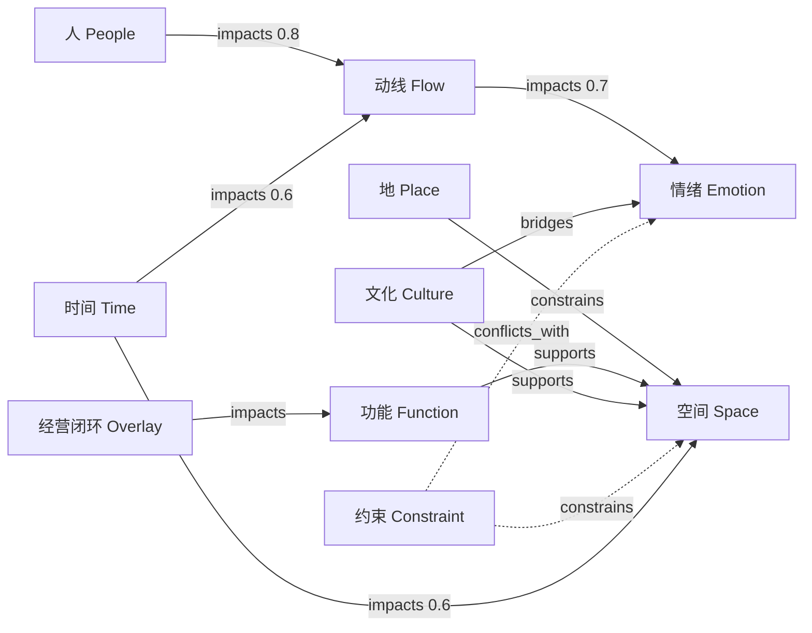

# 项目图谱（通用版）

> 版本：v1.2  
> 适用范围：空间设计行业多项目（民宿 / 酒店 / 商业 / 展陈 / 办公等）  
> 使用边界：仅呈现**项目本体内容**；不包含系统执行机制、任务编排、流程控制叙事。

---

## 1. 文档目标

以统一图谱语言替代线性文本，让团队在同一画面中回答三个核心问题：

1. 项目由哪些核心要素构成；
2. 要素之间如何支撑、冲突、牵引；
3. 空间结构、人群结构、情绪结构、文化结构如何组织；

一句话：把“项目”从段落叙述升级为可观察、可比较、可回溯的结构化世界模型。

---

## 1.1 参考吸收与独立边界（2026.3.11 交叉校验）

在“不碰执行流程、不管系统机制、只管项目本身”的原则下，吸收 `sf/2026.3.11/I 观察员/01-方案图谱观察员机制设计-Copilot-2026-03-14.md` 的可迁移思路如下：

### 采纳（用于补强本体可视化）

1. **镜像原则**：图谱是项目结构镜像，不反向定义项目真相。  
2. **可解释性原则**：每个关键节点/关系都应能回溯到证据来源。  
3. **盲区提醒原则**：低连接密度区域应被标记为“认知空白区”。  
4. **桥接价值原则**：重点识别连接两个子系统的桥接节点（如连廊、门厅、材质、光线）。  
5. **信息密度治理**：限制节点规模、过滤弱边，确保首屏可读。

### 不采纳（与当前边界冲突）

- 执行态状态机（如 streaming/pending/stable/deprecated）
- WebSocket/BroadcastChannel/多窗口同步机制
- 主链挂接、门禁联动、事件总线、服务架构分层描述
- 任何“由图谱触发流程动作”的机制

> 结论：仅吸收可视化方法，不吸收执行机制；避免从“项目本体图”回退到“系统运行图”。

---

## 2. 项目本体结构（9 维基础 + 1 条横切维度）

### 2.1 九维基础本体（固定骨架）

1. **人（People）**：业主、家庭成员、访客、服务人员、运营者、未来使用者
2. **地（Place）**：地理位置、气候、朝向、景观资源、在地文化
3. **空间（Space）**：建筑整体、模块、分区、子空间、室内外边界、灰空间
4. **功能（Function）**：居住、会客、餐饮、娱乐、工作、疗愈、收纳、后勤
5. **动线（Flow）**：主人/家人/访客/服务动线，高峰低峰切换，私密公共切换
6. **情绪（Emotion）**：仪式感、松弛、安全感、陪伴感、沉静、惊喜、疗愈
7. **文化与精神（Culture）**：家族叙事、身份表达、审美立场、地域性、当代性
8. **约束（Constraint）**：面积、预算、结构条件、法规、维护成本、运营要求
9. **时间（Time）**：日内变化、四季变化、长期老化、家庭结构变化、生命周期

### 2.2 横切维度（跨层表达）

- **经营闭环（Business Overlay）**：获客 → 转化 → 复购 → 传播

> 说明：横切维度不替代九维本体，用于表达项目“当下是否成立”。

---

## 3. 关系语法（统一连线规则）

图谱中统一使用以下关系：

- `supports`：支撑（A 支撑 B）
- `constrains`：约束（A 限制 B）
- `impacts`：影响（A 变化带动 B 变化）
- `conflicts_with`：冲突（A 与 B 存在张力）
- `bridges`：桥接（A 连接两个子系统）

规则建议：

- 所有边都应有方向；
- `impacts` 建议标注权重（0~1）；
- 关键结论必须可回溯到至少一条关系边。

---

## 4. 当下快照原则（不记录过程）

本图谱只描述“当前项目状态”，不记录历史过程，不追踪版本迁移。

为保证当前状态可读，节点仍允许三种**当下判定标签**（非过程状态）：

1. **已确认（Confirmed）**：当前可视为稳定事实
2. **高概率判断（Likely）**：当前最优解释
3. **待验证假设（Hypothesis）**：当前仍需补证

使用原则：

- 标签只代表“现在怎么看”，不表达“怎么变过来”；
- 不写迁移轨迹，不写版本差异，不写时间线过程。

补充：可在视觉上采用“事实层 + 推断层”双层阅读（而非执行层与稳定层）。

- **事实层（Fact Layer）**：已确认节点与高置信关系
- **推断层（Inference Layer）**：高概率判断与待验证假设

双层作用是提升认知清晰度，不表示任何流程权限或系统状态。

---

## 5. 可视化组合（1 主图 + 4 副图）

### 主图

1. **项目全景关系图**（项目脑图谱）

### 副图

2. **空间程序结构图**（空间骨架）
3. **动线关系图**（使用行为镜像）
4. **情绪体验曲线图**（心理旅程节奏）
5. **时间状态图**（当下时段/季节切片）

> 扩展建议：变量牵引图可作为 v1.1 或专题增强图，不强制首版上线。

---

## 6. 可视化图例（建议）

- **节点颜色（按九维）**
  - 蓝：人 / 功能
  - 绿：地 / 空间
  - 紫：动线 / 情绪
  - 橙：文化与精神 / 约束
  - 青：时间
  - 灰：横切维度（经营）

- **节点大小**
  - 与影响权重正相关（越大越关键）

- **线型**
  - 实线：supports / constrains
  - 虚线：impacts / bridges
  - 点划线：conflicts_with

- **节点外环**
  - 实心环：已确认
  - 半透明环：高概率判断
  - 虚线环：待验证假设

---

## 7. 三层阅读方式（避免图过载）

### L1 总览层（30 秒）

看九维本体是否齐全，核心目标与经营闭环是否一致。

### L2 结构层（3 分钟）

看“人-地-空间-动线-情绪”主影响路径是否闭合。

### L3 诊断层（10 分钟）

看风险热区、桥接节点、冲突节点。

### 读图优先级（防止迷航）

1. 先看核心节点（高权重）
2. 再看桥接节点（跨系统连接）
3. 最后看低密度区域（盲区）

---

## 7.1 信息密度与盲区检测规则

为保证图谱可读性与诊断价值，建议统一执行以下规则：

- **节点上限**：默认展示不超过 150 个核心节点
- **弱边过滤**：低于阈值（建议 0.2）的 `impacts` 边默认隐藏
- **桥接优先显示**：`bridges` 关系默认高亮
- **盲区标记**：聚类间连接密度低于阈值时，标注“认知空白区”
- **孤岛预警**：孤立节点超过总节点数 15% 时触发结构预警

> 阈值可按项目类型微调，但必须在同一项目内保持一致，以保证横向可比性。

---

## 8. 交叉校验规则（防拼盘采纳）

新增建议必须通过以下三问：

1. 是否改变了关键关系，而不是只新增名词？
2. 是否与现有高权重节点冲突？若冲突，裁决依据是什么？
3. 是否能落到主图或至少一张副图？不能落图则暂不采纳。

冲突处理原则：

- 不做“平均折中”，只做“证据优先”；
- 同时保留冲突假设时，必须标注为“待验证”并指定验证条件；
- 所有裁决只更新“当下快照”，不保留过程日志。

---

## 9. 通用填参模板（每个项目一页）

> 复制以下模板即可创建新项目图谱条目。

### 9.1 项目基础卡

- 项目名称：
- 项目类型：
- 场地位置：
- 核心命题：
- 成功标准：

### 9.2 九维本体填参

- 人（People）：
- 地（Place）：
- 空间（Space）：
- 功能（Function）：
- 动线（Flow）：
- 情绪（Emotion）：
- 文化与精神（Culture）：
- 约束（Constraint）：
- 时间（Time）：

### 9.3 横切维度

- 经营闭环（获客/转化/复购/传播）：
- 当前核心矛盾（当下）：
- 当前关键证据（当下）：

### 9.4 关键关系（至少 12 条）

- A `supports` B：
- A `constrains` B：
- A `impacts` B（权重）：
- A `conflicts_with` B：
- A `bridges` B/C：

### 9.5 风险热区

- 高风险（Top 3）：
- 中风险：
- 低风险：
- 缓释策略：

### 9.6 当下结论卡

- 当前核心节点（Top 5）：
- 当前桥接节点（Top 3）：
- 当前高风险项（Top 3）：
- 当前待验证假设：
- 当前优先处理建议：

---

## 10. 通用图谱骨架（示意）



---

## 11. 评审时只问 6 个问题

1. 九维本体是否完整，是否存在明显孤岛节点？
2. 经营闭环是否被显式映射到本体关系，而非停留口号？
3. 人-地-空间-动线-情绪主链是否闭合且可解释？
4. 桥接节点是否明确（如连廊、门厅、餐厅、材质、光线）？
5. 风险热区是否可定位、可解释、可缓释？
6. 当下结论是否清晰说明“现在最关键的矛盾与优先项”？

---

## 12. 最低落地标准（DoD）

一个项目图谱被视为可用，至少满足：

- 九维本体节点齐全；
- 关键关系 ≥ 12 条；
- 桥接节点 ≥ 3 个；
- 高风险节点 ≥ 3 个且有缓释策略；
- 已设置弱边过滤阈值与盲区密度阈值；
- 已完成 1 份“当下结论卡”；
- 团队可在 5 分钟内讲清项目结构、关键矛盾与当前优先项。

---

## 13. 备注

- 本文档是“项目本体可视化标准”母版；
- 各项目只替换参数与关系，不改语法；
- 本文档仅保留当下快照，不保留过程记录；
- 若出现跨项目复用冲突，以“证据优先 + 关系可解释 + 当下可判定”为优先。

---

## 14. 客观评估：当前文档处于“定义层”，尚未到“成品层”

基于主架构与参考意见交叉校验，当前《项目图谱》已具备：

- 本体骨架（九维）
- 关系语法（supports/constrains/impacts/conflicts_with/bridges）
- 可读性治理（节点上限、弱边过滤、盲区标记、孤岛预警）
- 阅读方法（L1/L2/L3）

但仍缺少将规范直接变成“截图级图谱成品”的四层能力：

1. **节点实例化层**：把“类别”落为具体项目节点清单
2. **关系生成层**：明确边如何产生（规则/候选/确认）
3. **渲染规则层**：布局、标签、冲突避让、缩放策略
4. **视图切片层**：同源数据切主图与副图

结论：当前文档可直接作为“图谱定义层”；若要形成成品，需补齐上述四层。

---

## 15. 交叉校验与冲突排查（非拼盘采纳）

### 15.1 可采纳结论

- “文档可支撑做图谱，但目前是规范不是成品”——采纳
- “应补数据结构化、关系生成、布局渲染、交互过滤”——采纳
- “不应机械照搬词网图，应做项目本体图”——采纳

### 15.2 冲突项与裁决

1. **冲突：词网导向 vs 对象导向**  
   裁决：以对象导向为主。词网只能作为候选线索，不能直接作为项目真相。

2. **冲突：高密炫图 vs 首屏可读**  
   裁决：优先可读性治理（节点上限、弱边过滤、桥接高亮）。

3. **冲突：过程展示 vs 当下快照**  
   裁决：严格执行“只保留当下”。所有过程性描述不进入图谱标准。

### 15.3 不采纳项（边界冲突）

- 任何系统执行机制、任务流转、状态推进的图谱化
- 仅凭词频共现自动连线并直接用于决策

---

## 16. 合理化执行思路（从规范到成品）

在“只管项目本体、只看当下”的前提下，建议按以下四步推进：

### Step 1｜节点实例化（产出：节点清单）

- 输入：项目基础信息 + 九维填参
- 产出：标准化节点表（id、label、type、status、weight、evidence）
- 目标：把抽象维度变成可渲染对象

#### Step 1.1｜中文词组提取机制（新增）

图谱节点以**中文精准词组**为最小表达单位，不使用长句作为节点。

- 允许：名词词组、动宾词组、专有语义短语（建议 2~8 字，必要时可到 12 字）
- 禁止：完整长句、并列复句、含多重因果的描述句直接入图
- 目标：让节点可读、可聚类、可连边，避免句子噪声污染

建议的提取与清洗规则：

1. **分词标准化**：统一全角/半角、数字格式、同义词归一（如“私密性/私密度”归并）
2. **词组优先**：优先保留“可独立指代对象/关系”的短语（如“私密梯度”“景观借位”）
3. **停用过滤**：去除空泛词（如“这个、那个、感觉、可能、比较”）
4. **长句拆分**：遇到长句先拆成“对象词组 + 关系词组 + 约束词组”再入图
5. **证据对齐**：每个词组必须能回溯到文本片段，不可凭空生成

### Step 2｜关系生成（产出：关系清单）

- 生成策略：规则主干 + 候选补充 + 关键边人工确认
- 产出：关系表（source、target、relation、weight、evidence）
- 目标：保证关系可解释，不落入“共现即因果”误区

补充：关系生成的输入应为“词组节点”，不是原始句子。句子仅作为证据来源。

### Step 3｜图谱渲染（产出：主图 + 4副图）

- 主图：项目全景关系图
- 副图：空间程序结构图 / 动线关系图 / 情绪体验曲线图 / 时间状态图
- 目标：同源数据，多视图一致，不重复建模

### Step 4｜治理校验（产出：当下结论卡）

- 必做检查：弱边过滤、盲区标记、孤岛预警、桥接节点高亮
- 产出：当下核心节点、关键矛盾、高风险项、优先建议
- 目标：从“图像展示”升级到“可用判断”

---

## 17. 附录A：图谱数据合同（最小可用版）

> 用于把本规范直接落为可渲染数据。仅表达“当下状态”。

```json
{
  "project_id": "project_xxx",
  "snapshot_at": "2026-03-26",
  "nodes": [
    {
      "id": "people_owner_01",
      "label": "第一代创业者",
      "phrase": "第一代创业者",
      "phrase_len": 6,
      "source_lang": "zh-CN",
      "type": "People",
      "status": "Confirmed",
      "weight": 0.92,
      "evidence": ["访谈纪要A-03"]
    },
    {
      "id": "emotion_achievement_01",
      "label": "成就感",
      "phrase": "成就感",
      "phrase_len": 3,
      "source_lang": "zh-CN",
      "type": "Emotion",
      "status": "Likely",
      "weight": 0.81,
      "evidence": ["需求文本段落-12"]
    }
  ],
  "edges": [
    {
      "source": "people_owner_01",
      "target": "emotion_achievement_01",
      "relation": "impacts",
      "weight": 0.88,
      "evidence": ["访谈纪要A-03"]
    }
  ],
  "current_summary": {
    "core_nodes_top5": [],
    "bridge_nodes_top3": [],
    "high_risks_top3": [],
    "key_conflict_now": "",
    "priority_actions_now": []
  }
}
```

字段约束：

- `type` ∈ {People, Place, Space, Function, Flow, Emotion, Culture, Constraint, Time}
- `status` ∈ {Confirmed, Likely, Hypothesis}
- `relation` ∈ {supports, constrains, impacts, conflicts_with, bridges}
- `weight` 范围为 $[0, 1]$
- `phrase` 必须为中文精准词组，不得为长句
- `phrase_len` 建议区间为 2~8（特殊专有词组可放宽到 12）

中文词组质量门槛（建议）：

- 节点中“长句标签（>12 字）”占比 ≤ 5%
- 高频空泛词占比 ≤ 3%
- 可回溯证据覆盖率 ≥ 95%

---

## 18. 附录B：最小验收清单（成品可交付）

- 已生成节点清单（≥ 40）与关系清单（≥ 12）
- 主图与 4 副图使用同一份数据源
- 盲区标记与孤岛预警可见
- 当下结论卡完整可读（核心节点/风险/优先项）
- 任一关键关系可追溯证据来源
- 节点标签以中文精准词组为主，无长句噪声